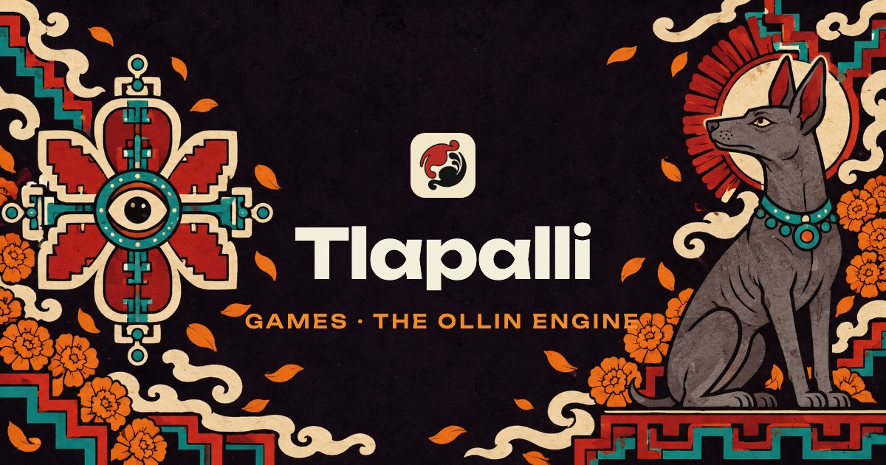

<p align="center"></p>

**Tlapalli** (*tla-PAHL-lee*, "red ink") is a small game studio, proudly made in Mexico 🇲🇽. We make games, and the engine that runs them, painted in the red and black ink of the Mexica codices: *in tlilli, in tlapalli*.

🌐 **[tlapalli.github.io](https://tlapalli.github.io)**: play Xolo in your browser.

## What we make


**[Ollin](https://github.com/Tlapalli/ollin)** (*OHL-leen*, "movement"): a fast 2D/2.5D game engine in TypeScript, with a data-oriented core and a small, friendly API. WebGL2 and WebGPU, Rapier physics, Tiled maps. Open source under MIT.

```bash
npm create ollin@latest my-game
```

[Docs](https://tlapalli.github.io/docs/getting-started/) · [npm](https://www.npmjs.com/package/@tlapalli/ollin) · [Website](https://tlapalli.github.io/ollin/)

**Xolo**: a xoloitzcuintli gathers cempasúchil petals through Mictlan while obsidian spirits hunt it down. [Play it](https://tlapalli.github.io/#games).
